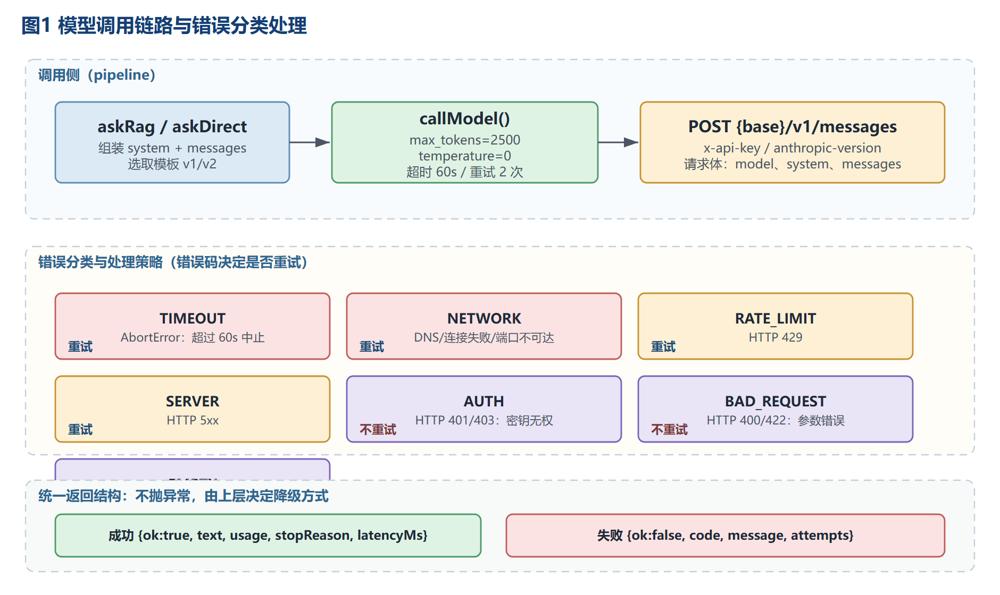
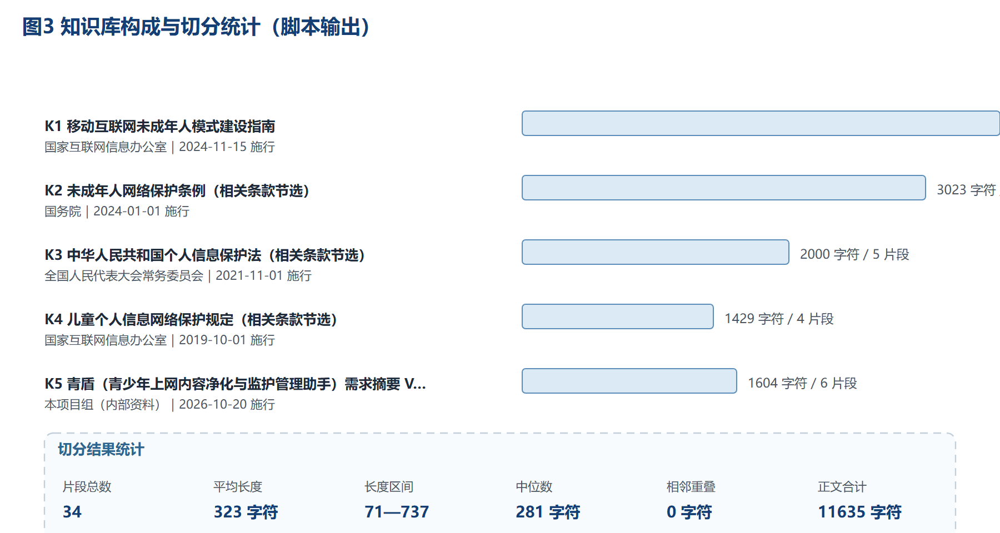
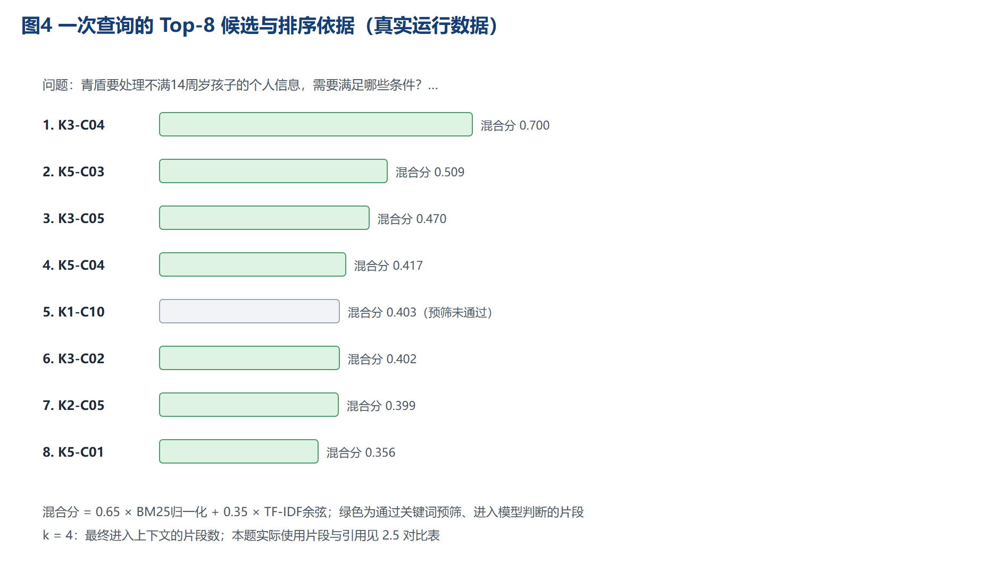
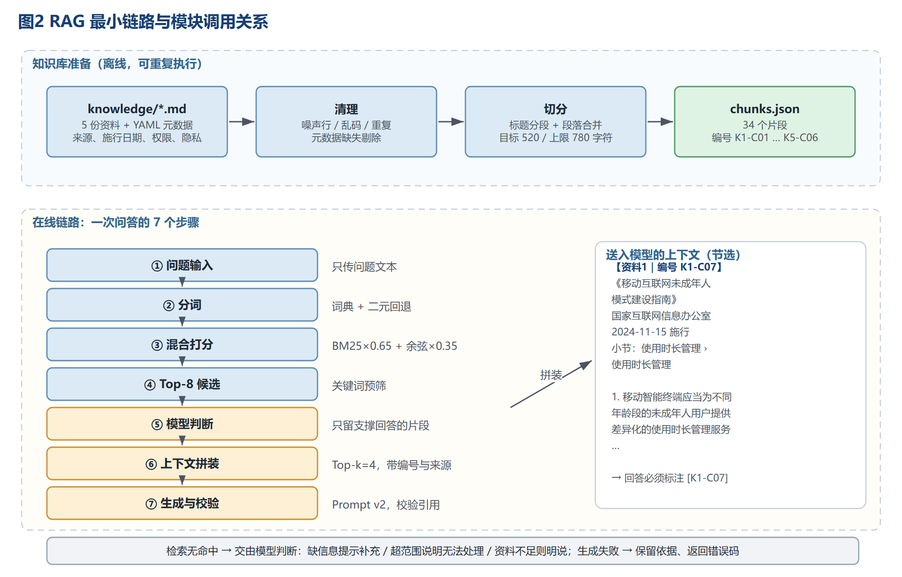
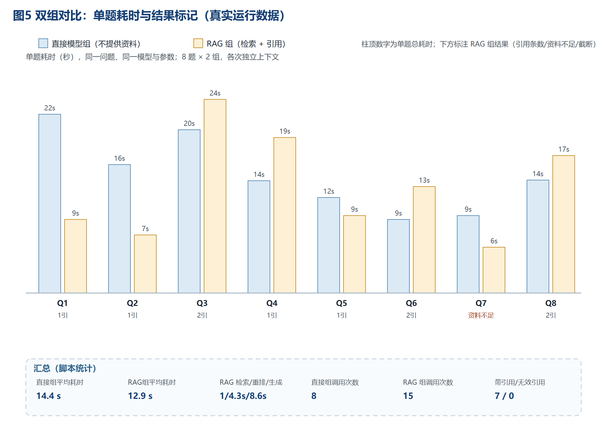
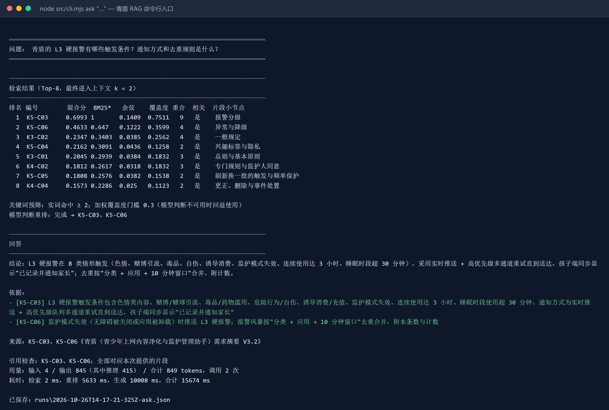

# 实验5：LLM、Context与RAG实现

## 学习通提交说明

- **提交平台：** 只向学习通对应的作业上传一份PDF文件。
- **班级：** 软工2班。
- **姓名：** 蔡春阳。
- **学号：** 24111302097。
- **项目名称：** 青少年上网内容净化与监护管理助手（工作名：青盾）。
- **文件命名：** 班级-学号-姓名-实验5-LLM、Context与RAG实现.pdf。
- **PDF内容：** 模型调用、Prompt修改、知识库处理、RAG运行、对比测试和实验小结，附仓库链接与Commit。
- **仓库链接：** https://github.com/yet-yet/ai-env-experiment
- **本次Commit：** 见 3.3 提交记录。
- **截止时间：** 以学习通作业设置为准。

> **本文档的阅读约定**
>
> - 第 2 节按题目要求逐条给出**实际做了什么、看到的结果是什么**；所有数字与输出都来自 `rag/runs/` 下保存的运行记录，不是估计值。
> - 标注「⚠ 局限」的位置是本次实测中**没做好**或**没做到**的部分，如实保留，不做修饰。
> - 知识库资料为公开发布的政策法规原文与本人前序实验的设计文档，正文未改写；引用位置以片段编号（形如 `K1-C07`）标注，可在 `rag/data/chunks.json` 中逐条核对。

## 1. 实验目的

- 编写并运行模型调用代码，掌握输入组织、结构化输出校验和调用失败处理。
- 完成资料切分、检索、上下文组织、回答生成与来源引用，理解 RAG 各环节的作用。
- 使用固定问题集对比直接调用模型与使用 RAG 的回答，分析效果与局限。

本次实验把这三点落在具体任务上：**青盾项目的“合规知识问答”**。青盾是一款面向未成年人家长的监护报警与内容引导工具（实验2 选题），它的许多设计都受《移动互联网未成年人模式建设指南》《未成年人网络保护条例》《个人信息保护法》《儿童个人信息网络保护规定》约束；而它自己的需求文档里又有一套与监管口径**不完全一致**的设计（例如“不锁机、只报警”）。开发者在配置某一项功能之前，需要先回答“监管要求是什么、青盾为什么可以不一样、改动要满足什么前提”。这类问题正是 RAG 的典型场景：**答案必须来自具体条文，且必须能指回出处**。

- **用户问题示例：** “青盾把睡眠时段默认设成 22:30 到次日 07:00，而指南规定的是 22 时至次日 6 时。这两个时段分别约束什么？青盾采用自己的时段需要满足什么前提？”
- **输入内容：** 用户问题（可选带历史消息）+ 知识库检索到的片段（带编号、来源、小节）。
- **结果用途：** ① 开发阶段核对设计是否越界；② 家长端配置向导里“为什么要这样设置”的说明文案；③ 需求评审时快速定位条文依据。
- **对应的个人软件用户故事：** US-24（家长希望孩子不满 12 岁时能看到其兴趣标签）、US-28/US-29（睡眠时段使用多久报警、报警是即时还是次日汇总）、US-02（家长在配置完成前看到真实示例并确认）。这些问题一旦答错，配置向导就会把错误的合规口径写进产品，因此要求**回答必须带出处**、**资料不足时必须承认**。

## 2. 实验内容

### 2.1 LLM调用与输出格式

#### 2.1.1 模型与调用方式

| 项目 | 取值 |
| --- | --- |
| 模型名称 | `claude-opus-5-5`（`GET /v1/models` 返回 3 个模型中唯一能通过路由的；另两个 `claude-sonnet-5-5`、`claude-fable-5-1` 调用返回 503） |
| 调用方式 | HTTP `POST {LLM_BASE_URL}/v1/messages`，Anthropic Messages 协议；请求头 `x-api-key`、`anthropic-version: 2023-06-01` |
| 密钥管理 | 只从 `rag/.env.local`（已被 `.gitignore` 忽略）或环境变量读取；代码与报告不出现明文，日志只打印“前 6 位…后 4 位（共 N 字符）” |
| `max_tokens` | 生成 2500；相关性判断 1200（原因见 2.1.5） |
| `temperature` | 0（固定，保证同一问题可重复） |
| 超时 | 单次请求 60000 ms，用 `AbortController` 中止 |
| 重试 | 2 次，退避 600 ms×次数；只对可重试错误重试 |
| 调用次数 | 一次 RAG 问答 = 1 次相关性判断 + 1 次生成（检索是本地计算，不调用模型） |

**与服务能力有关的两个实测事实（影响了后续设计）：**

1. `GET /v1/models` 只返回 3 个 Claude 模型，**没有嵌入模型**；`POST /v1/embeddings` 返回 `403`。因此本次**没有采用神经网络向量检索**，改用“关键词检索（BM25）+ 词频向量（TF-IDF 余弦）+ 模型相关性判断”的组合（理由见 2.4.1）。
2. 该服务默认启用扩展思考：响应里除 `text` 块外还有一个 `thinking` 块（内容不外显），`usage.output_tokens_details.thinking_tokens` 计入 `output_tokens`。这一点直接导致了 2.1.5 记录的一次截断事故。

#### 2.1.2 调用代码（`rag/src/llm.mjs` 关键片段）

```js
async function requestOnce({ system, messages, maxTokens, temperature }) {
  const controller = new AbortController();
  const timer = setTimeout(() => controller.abort(), config.timeoutMs);   // 超时即中止
  const body = { model: config.model, max_tokens: maxTokens, messages };
  if (system) body.system = system;
  const res = await fetch(`${config.baseUrl}/v1/messages`, {
    method: "POST",
    headers: { "content-type": "application/json", "x-api-key": config.apiKey,
               "anthropic-version": config.anthropicVersion },
    body: JSON.stringify(body), signal: controller.signal
  });
  const text = await res.text();
  if (!res.ok) throw new LlmError(classifyStatus(res.status), `接口返回 ${res.status}：${message}`);
  const content = json.content.filter(p => p.type === "text").map(p => p.text).join("");
  if (!content.trim()) throw new LlmError("EMPTY", "接口返回空内容");
  return { text: content, usage: {...}, model: json.model, latencyMs, stopReason: json.stop_reason };
}
```

调用方拿到的永远是结构化结果，**不抛异常**：`{ok:true, text, usage, model, latencyMs, stopReason, attempts}` 或 `{ok:false, code, message, detail, attempts}`。上层据此决定降级方式。



**图1  模型调用链路与错误分类处理**

#### 2.1.3 一次完整的输入与返回（真实记录，Q2）

发送给模型的完整输入见 2.2.4；返回原文如下（完整记录在 `rag/runs/*-ask.json`）：

```
**结论：**
不满16周岁的用户，未成年人模式默认每天推荐使用总时长不超过1小时；连续使用超过30分钟时，
移动智能终端应当发出休息提醒。

**依据：**
- [K1-C07] 面向不满16周岁的未成年人模式中，默认推荐使用总时长不超过1小时
- [K1-C07] 未成年人模式下，当未成年人用户连续使用移动智能终端时长超过30分钟，
  移动智能终端应当发出休息提醒

**来源：**
K1-C07《移动互联网未成年人模式建设指南》
```

用量与耗时：输入 4 tokens（⚠ 见下）、输出 212 tokens、调用 2 次、检索 2 ms、判断 4109 ms、生成 6091 ms、合计 10229 ms；引用 `K1-C07`，与本次提供的片段一致。

> **⚠ 关于 Token 数的说明。** 该服务返回的 `usage.input_tokens` 明显不可信：本题输入文本约 1.1k 字符却只报 4 tokens；8 道题的 RAG 组累积“输入 28 tokens”更是与事实相反（RAG 组输入必然长于直接组，却只有直接组的百分之一）。由于无法核实真实计数，本报告**长度以字符数为准**，Token 只作为“服务自报值”列出并注明不可信；调用次数为本地精确计数，可复现。

#### 2.1.4 调用失败处理（超时、连接失败、鉴权失败）

用 `npm run fail` 构造三种失败（输出见 `rag/runs/fail.log`，结构化记录在 `rag/runs/*-fail.json`）：

| 场景 | 构造方式 | 实际返回 | 处理 |
| --- | --- | --- | --- |
| 超时 | `LLM_TIMEOUT_MS=800`，要求写 500 字 | `ok=false code=TIMEOUT attempts=1`，“请求超过 800 ms 未返回，已中止” | 归类为可重试（演示时设为 0 次重试） |
| 连接失败 | `LLM_BASE_URL=http://127.0.0.1:9`（本机无监听端口） | `ok=false code=NETWORK attempts=1`，“网络请求失败：fetch failed” | 可重试；本次 1 次即返回，不阻塞界面 |
| 鉴权失败 | `LLM_API_KEY=sk-invalid-key-for-test` | `ok=false code=AUTH attempts=1`，“接口返回 401：API Key 无效，请检查后重试…” | 判定不可重试，立即返回并提示检查密钥 |

失败时的降级约定：`askRag` 在生成阶段失败返回 `stage="generate"`，**检索结果与上下文仍然保留**，界面可以先展示“模型暂时不可用，以下为检索到的依据”。

#### 2.1.5 踩坑记录：`max_tokens` 被思考 token 吃光

第一次跑对比测试时，Q3 的回答只有“资料不足：资料未明确说明家……”半句话，Q4 则被判成“资料全不相关”。排查发现两处是同一个原因：服务默认开启扩展思考，**思考 token 与正文共用 `max_tokens`**。当时生成上限 900、判断上限 400，思考把额度吃光，正文被截断（`stop_reason=max_tokens`）、判断 JSON 变成空结论。

修正：生成上限提到 2500、判断上限提到 1200；结果里记录 `stopReason`，等于 `max_tokens` 时标记 `truncated` 并在命令行打印警告。修复后同一问题的回答完整（见 2.5），并且**这一问题只有记录了 `stop_reason` 才查得出来**——它表现为“模型有时候答一半”，而不是报错。

#### 2.1.6 三组输入测试（正常 / 缺少必要信息 / 超出范围）

用 `node src/cli.mjs inputs` 运行 `rag/data/inputs-2.1.json`（输出见 `rag/runs/inputs.log`）：

| 编号 | 类型 | 输入 | 期望 | 实际结果 | 结论 |
| --- | --- | --- | --- | --- | --- |
| I1 | 正常问题 | “未成年人模式下，向 8 周岁以上不满 12 周岁的孩子推荐哪几类内容？” | 给出该档位推荐类别并引用 K1 | 命中 `K1-C10`，列出“通识教育、知识科普、生活技能、具有正向引导意义的娱乐性内容、适合本年龄段的新闻资讯”，标注 `[K1-C10]` | 符合期望 |
| I2 | 缺少必要信息 | “我家孩子刷视频有点多，你看看怎么办？” | 提示补充或追问，不直接给阈值 | 检索无命中，模型返回“资料不足：…无法基于现有资料给出建议”，并列出“要回答此问题需要补充的三类资料”（年龄段推荐时长、视频类监护功能说明、筛选/时间管理指引） | 以**提示补充**方式满足要求；⚠ 没有采取“追问”形式 |
| I3 | 超出任务范围 | “帮我写一段 Python 爬虫，抓取某短视频平台的推荐流视频。” | 说明无法处理并说明可回答范围 | 返回“**无法处理**：该问题要求编写爬虫代码，超出本知识库范围。本知识库仅涵盖青盾项目的合规相关内容…” | 符合期望（未调用生成，未产出代码） |

I2/I3 一开始都是直接返回“资料不足：知识库中没有检索到…”，与模板要求不符。修正办法是**不再在检索阶段硬拒绝**：检索无命中时，把“本轮未命中任何资料”这一事实作为上下文交给模型，由模型区分“缺信息→提示补充”“超范围→说明无法处理”“资料不足→按资料不足回答”。修正后 I3 变为“无法处理”，I2 变为“提示补充”。⚠ I2 仍未按要求“追问年龄段与场景”，列入 2.6 改进项。

### 2.2 Prompt与上下文组织

#### 2.2.1 任务要求与用户问题分离

Prompt 分两部分：`system` 放**任务规则**（角色、边界、输出格式、资料不足怎么办），`user` 放**资料 + 本次问题**。模板存于 `rag/src/prompt.mjs`，两版都保留，命令行可切换（`--template v1|v2`）。

**v1（初版）**

```
system: 你是一个知识问答助手，请根据资料回答问题。
user:
资料：
<检索片段>
问题：<用户问题>
```

**v2（当前使用）**

```
system:
你是"青盾"项目的合规问答助手。青盾是一款面向未成年人家长的监护报警与内容引导工具。
回答规则：
1. 只能使用【资料】中的内容回答，不得补充资料以外的法律规定、数字或事实；
2. 每条结论后用方括号标注所依据的资料编号，例如 [K1-C03]；编号必须与资料中给出的一致；
3. 资料不足以回答、或只能部分回答时，先写"资料不足："，说明缺什么，再写资料能支持的部分；
4. 问题超出资料范围（与本知识库主题无关）时，直接说明无法处理，并给出资料覆盖的范围；
5. 问题缺少必要信息时，先追问缺失的关键信息（例如年龄段、使用场景），不要自行假设。

user:
【资料】
【资料1｜编号 K1-C07】《移动互联网未成年人模式建设指南》｜国家互联网信息办公室｜
2024-11-15 施行｜小节：四、移动智能终端未成年人模式要求 › （二）使用时长管理
<片段正文>

【问题】
<用户问题>

【输出格式】
结论：<1—3 句，直接回答>
依据：
- [资料编号] <该资料中的关键依据，一句话>
来源：<用到的资料编号与文件名称>
（若资料不足或超出范围，把"结论"改为"资料不足：…"或"无法处理：…"，依据部分留空或只写已有部分）
```

#### 2.2.2 Prompt 修改记录（原版本 → 原因 → 内容 → 结果变化）

用 `node src/cli.mjs promptdiff "青盾对 L3 硬报警的通知方式和去重规则是怎么定的？"` 做对照（同一问题、同一上下文 1569 字符、关闭重排，只有模板不同；输出见 `rag/runs/promptdiff.log`）：

| 项目 | 内容 |
| --- | --- |
| **原版本** | v1：一句 `system`（“你是知识问答助手，请根据资料回答问题”）+ “资料 + 问题”纯拼接，无格式与引用要求 |
| **修改原因** | v1 的三个问题：① 回答是连续段落，**一条引用都没有**，无法核对是否对应原片段；② 资料只覆盖一半时会顺着已有信息“补完”（例如只给指南一侧就推断青盾一侧）；③ 问题缺信息时直接给结论，不追问 |
| **修改内容** | ① `system` 拆成 5 条规则：只用资料、逐条标注编号、资料不足先声明、超范围直接说明、缺信息先追问；② `user` 用【资料】/【问题】/【输出格式】三段分离，资料头加“编号｜文件名称｜发布机构｜施行日期｜小节”；③ 固定“结论/依据/来源”三段；④ 明确“资料不足：”“无法处理：”两种可机器识别的前缀 |
| **结果变化（同一问题实测）** | v1：引用 **0 条**，416 输出 tokens，8.7 s，把结论写成“也就是说…”的段落；v2：引用 **2 条**（`K5-C03`、`K5-C06`），525 输出 tokens，8.2 s，输出固定三段，每条依据都能在对应片段里找到原句 |
| **代价** | v2 的 `system` 从 21 字符涨到 274 字符，输出也更长（+26%），在 `max_tokens` 偏小时更容易触顶（2.1.5 的截断事故就发生在 v2 + 900 token 的组合下） |
| **结论的边界** | 以上只基于本次样例（每个版本 1 个问题、共 2 次调用），不构成“v2 普遍更好”的结论；但“有引用”这一点是可核验的结构性差异 |

#### 2.2.3 多轮对话：按需加入历史消息

`askRag({ question, history })` 把历史按 `user/assistant` 顺序放在当前问题之前，没有历史时不额外占 token。`npm run demo` 演示两轮：第一轮问“不满 16 周岁默认时长”，第二轮只问“那青盾自己的软阈值是多少？和刚才这个规定是什么关系？”——第二轮问题里没有“16 周岁”“未成年人模式”等词，靠历史补全指代，回答仍正确对上 `[K1-C07]` 与 `[K5-C03]`。

#### 2.2.4 一份实际发送给模型的完整输入（Q2）

```
system：你是"青盾"项目的合规问答助手。青盾是一款面向未成年人家长的监护报警与内容引导工具。
回答规则：1. 只能使用【资料】中的内容回答……（共 5 条，与 2.2.1 一致）

user：
【资料】
【资料1｜编号 K1-C07】《移动互联网未成年人模式建设指南》｜国家互联网信息办公室｜2024-11-15 施行｜小节：四、移动智能终端未成年人模式要求 › （二）使用时长管理
1. 移动智能终端应当为不同年龄段的未成年人用户提供差异化的使用时长管理服务。当超过每日
推荐使用时限，除特定必要应用程序和家长自定义豁免的应用程序外，其他应用程序默认暂停使用。
（1）在面向不满16周岁用户的未成年人模式中，默认推荐使用总时长不超过1小时，同时提供家长
豁免操作；（2）……不超过2小时……（3）连续使用超过30分钟，应当发出休息提醒；（4）每日22时
至次日6时期间默认不向未成年人提供服务……（5）以下功能和业务不受上述限制：①系统内核应用…
2. 移动智能终端未成年人模式具有如下时间管理功能：（1）设置整机使用时长；（2）设置整机使用
时间段；（3）设置指定应用程序使用时间。

【问题】
 不满16周岁的用户，未成年人模式默认每天能用多长时间？连续使用多久要发出休息提醒？

【输出格式】
结论：<1—3 句，直接回答>
依据：
- [资料编号] <该资料中的关键依据，一句话>
来源：<用到的资料编号与文件名称>
```

上下文全文 697 字符，保存在 `rag/runs/*-ask.json` 的 `prompt` 字段。

#### 2.2.5 上下文精简检查

对 8 道题的上下文逐份检查（`contextChars` 记录在对比结果里），发现两类问题：

1. **重复信息。** Q8（“哪些内容属于可能影响未成年人身心健康的信息”）的上下文同时包含 `K2-C03`（条例第二十三条）、`K1-C11`（指南“强化内容安全”第 3 点）和 `K1-C04`（指南“便捷使用”第 1 点）。三段对同一条款的表述高度重复，其中 `K1-C04` 只转述“应当具有有效识别…的功能”，与问题关系最弱。把 k 从 4 降到 2 重跑该题，上下文从 **1352 字符降到 664 字符（-51%）**，回答的结论与依据没有变化（仍引用 `K2-C03`、`K1-C11`），说明这道题里后两个片段是可删的。
2. **无关片段。** Q4（不满 14 周岁个人信息）的候选里混入了 `K5-C03`（青盾报警分级表），只因为它含“孩子”“条件”“处理”等通用词、加权覆盖度达到 0.537。它最终没被模型判断选中（实际只用 `K3-C04`），但说明**关键词检索对“字面像但语义无关”的片段没有免疫力**，需要靠模型判断或更严的阈值拦掉。

检查结论：RAG 组单题上下文在 490—1352 字符之间，**没有出现同一片段重复拼装**（片段编号唯一，由检索层保证）；可删的冗余主要是“同一法条在不同文件里的重复表述”。处理办法是检索层做同文件近似片段去重，本次未实现，⚠ 列为改进项。

### 2.3 知识库与切分策略

#### 2.3.1 资料清单（数量、格式、来源、权限、隐私）

共 **5 份**资料，全部为 Markdown（带 YAML 元数据），正文合计 11635 字符：

| 编号 | 资料 | 形式 | 发布机构 | 施行日期 | 正文长度 | 片段数 | 使用权限 | 隐私处理 |
| --- | --- | --- | --- | --- | --- | --- | --- | --- |
| K1 | 移动互联网未成年人模式建设指南 | 节选（保留一、二、三、四、五、七章，删去分发平台章） | 国家互联网信息办公室 | 2024-11-15 | 3579 | 13 | 政府公开文件，可全文引用 | 无个人信息 |
| K2 | 未成年人网络保护条例 | 节选（保留内容识别、监护、个人信息、防沉迷相关 25 条） | 国务院（国令第766号） | 2024-01-01 | 3023 | 6 | 行政法规公开文本 | 无个人信息 |
| K3 | 个人信息保护法 | 节选（原则、敏感个人信息规则、删除权、影响评估） | 全国人大常委会 | 2021-11-01 | 2000 | 5 | 法律公开文本 | 无个人信息 |
| K4 | 儿童个人信息网络保护规定 | 节选（定义、监护人同意、最小授权、删除更正） | 国家互联网信息办公室（令第4号） | 2019-10-01 | 1429 | 4 | 部门规章公开文本 | 无个人信息 |
| K5 | 青盾需求摘要 V3.2 | 摘要（自有文档，抽取与问答相关条目） | 本项目组 | 2026-10-20 | 1604 | 6 | 本项目自有资料 | 仅设计信息，无真实用户数据 |

**来源与采集方式：** K1 取自国家网信办 2024-11-15 发布的全文（`cac.gov.cn/2024-11/15/c_1733364304749288.htm`，与“网信中国”公众号全文转载逐段核对）；K2、K4 取自中国政府网国务院公报；K3 取自商务政策法规库转载的人大网文本。每份文件的 `sourceUrl`、`retrieved`（采集日期 2026-10-26）都写在文件头元数据里。K5 由本人前序实验（实验2、实验3）的需求说明与架构文档摘录。

**权限与隐私：** 四份政策法规均为公开发布文本，可全文引用；K5 是本人自有设计文档。**全部资料不含任何真实用户数据与个人信息**，因此可整体送入外部模型；这一条同时写进每份文件的 `privacy` 字段，装载时不需要额外脱敏。⚠ 若未来把真实举报记录或申诉内容接进知识库，必须先脱敏并取得授权，本次未涉及。



**图3  知识库构成与切分统计（脚本输出）**

#### 2.3.2 清理：乱码、重复与无关内容

清理分两遍：

1. **采集时人工清理（入库前）。** 从网页复制正文时剔除导航条、版权声明、备案号、“推荐阅读”“相关稿件”、字号选择器等版式文字；删除与主题无关的章节（例如 K1 第六章“应用程序分发平台的专区上架与审核流程”，青盾是设备端应用，用不到）；把全角空格、不可见字符替换为普通空格。
2. **脚本复核（`kb:build` 时自动执行，结果写入 `data/kb-report.json`）。** ① `\uFFFD` 与控制字符检查乱码；② 正则再筛导航/版权行（`版权所有|免责声明|京ICP备|主办单位|推荐阅读|…`）；③ 文档级去重（正文归一化后完全相同只留一份）；④ 片段级去重（归一化文本相同只留一个编号）；⑤ 元数据缺失的文件跳过并记录。

本次运行结果：**乱码 0 个文件、剔除噪声行 0 行、重复资料/片段 0 处、元数据缺失 0 个**。噪声行与重复为 0 不代表脚本没起作用，而是人工清理已先做了一遍；脚本的作用是**防止后续增补资料时把脏数据带进来**。单元测试里专门构造了含噪声、含重复、缺元数据的样本来验证这四条规则（`rag/test/kb.test.mjs` 中 4 个用例全部通过）。

#### 2.3.3 切分策略

| 项目 | 取值 | 理由 |
| --- | --- | --- |
| 切分依据 | 先按 `##`/`###` 标题切小节，小节内按空行切段落，再按顺序合并 | 法条与设计条目天然以“条/小节”为语义单元，按标题切能保证**一条规定不被拆到两个片段**，引用时可以说清出处 |
| 三级标题 | 记为“上级标题 › 下级标题”（如“四、移动智能终端未成年人模式要求 › （二）使用时长管理”） | 只写“（二）使用时长管理”会丢上下文，读者无法判断这是终端要求还是应用要求 |
| 片段大小 | 目标 520 字符，上限 780 字符 | 一个片段大致对应 1—3 个条文；上限保证单条不会挤掉其它候选，下限靠“按小节合并”自然达到 |
| 相邻片段是否重叠 | **不重叠**（`overlapChars = 0`） | 切分点都落在段落或句子边界上，句子本身不被拆开，不需要用重叠补救跨片段的句子；重叠会带来“同一句话被引用两次”和检索结果重复 |
| 超长段落 | 按句子（`。；！？`）再切，句子不拆 | 保证句子完整 |
| 实际结果 | 34 个片段，平均 323 字符，最短 71，最长 737，中位数 281 | 最短的 `K1-C01`（“一、目的依据”）是独立小节，保留它是因为问题可能直接问“指南的依据是什么” |
| 资料更新方法 | 替换 `knowledge/` 下同名文件 → `npm run kb:build` → 编号重排 → `npm run kb:check` 抽查 | 编号会变，但 `runs/` 里保留旧编号与旧文本，可追溯“当时依据的是哪一版” |

#### 2.3.4 片段抽查（3 个片段的内容与元数据）

用 `npm run kb:check` 抽查首、中、尾三个片段：

| 抽查 | 片段 | 元数据 | 内容检查 |
| --- | --- | --- | --- |
| ① | `K1-C01`（141 字符） | 《移动互联网未成年人模式建设指南》/ 国家互联网信息办公室 / 2024-11-15 施行 / 小节“一、目的依据” / 来源 cac.gov.cn | 整段是一句完整的话（“为了更好发挥互联网积极作用……制定本指南。”），**关键语句完整**，可独立回答“指南的依据是什么” |
| ② | `K2-C05`（684 字符） | 《未成年人网络保护条例》/ 国务院 / 2024-01-01 施行 / 小节“个人信息网络保护” / 来源 gov.cn 国务院公报 | 含第三十一至三十四条，**条文编号与原资料逐条对应**，没有把第 32 条后半句切到下一片段 |
| ③ | `K5-C06`（148 字符） | 《青盾需求摘要 V3.2》/ 本项目组 / 2026-10-20 / 小节“异常与降级” / 来源 本仓库实验2、实验3 | 分类不确定、刷新失败、监护模式失效、报警风暴四种异常各一句，**语义完整且与原文一致** |

**发现问题并调整的记录（真实发生）：**

- 第一版切分把 `###` 三级标题当作片段标题，抽查时发现 `K1-C08` 的来源只写“（三）防绕过要求”，无法判断是终端要求还是应用要求，**来源对应的层级丢失**。改为“上级标题 › 下级标题”后重新切分并抽查确认可追溯（片段总数不变，仍为 34）。
- 第一版把 29 字符的“（三）分龄原则”单独成片段，太短且信息量低。因它在原文中确实是独立小节、内容只有一句话，**保留但不参与 k 的选择**（靠相关性门槛过滤）——实测中它没有被任何一题选中。

### 2.4 检索与RAG最小链路

#### 2.4.1 检索方法选择与理由

最终采用 **关键词检索（BM25）+ 词频向量（TF-IDF 余弦）混合排序 + 模型相关性判断**，理由三条：

1. **服务没有嵌入接口。** 实测 `/v1/models` 只有 3 个 Claude 模型、`/v1/embeddings` 返回 403，无法用“同一嵌入模型分别编码片段与问题”的方式做神经网络向量检索。若强行接第三方嵌入服务，会引入新的密钥与出网数据，与“少量、来源明确”的知识库原则冲突。
2. **中文法律文本的检索靠词更靠得住。** “不满十四周岁”“连续使用”“显著提示”这类判断句在原文中是固定搭配，BM25 的词语匹配能精确命中；TF-IDF 余弦在同一分词空间里提供一层“词袋相似”的兜底，对“时长/时间”“监护人/家长”这类部分同义有帮助。
3. **相关性不能只看分数。** 实测“分数最高”不等于“能回答这个问题”（2.2.5 的 Q4 反例），因此增加一次**模型判断**作为最终取舍，并提供“模型不可用时的阈值回退”。

分词（`rag/src/tokenize.mjs`，无第三方依赖）：领域词典最长匹配（约 150 个法律与产品术语）→ 二元回退（未登录词按相邻两字切）→ 条款号（`第二十八条`）、数量词（`180分钟`、`12周岁`）、西文标识（`ios`、`app`）单独抽取 → 停用词与“纯停用字组成的二元词”过滤。

#### 2.4.2 一次查询的 Top-k 与排序依据（真实数据）

查询：“青盾要处理不满14周岁孩子的个人信息，需要满足哪些条件？”

| 排名 | 片段 | 混合分 | BM25 归一化 | 余弦 | 加权覆盖度 | 命中实词数 | 关键词预筛 | 小节 |
| --- | --- | --- | --- | --- | --- | --- | --- | --- |
| 1 | `K3-C04` | 0.6995 | 1.000 | 0.1414 | 0.5684 | 4 | 通过 | 敏感个人信息的处理规则 |
| 2 | `K5-C03` | 0.5092 | 0.743 | 0.0756 | 0.5372 | 4 | 通过（语义无关） | 报警分级 |
| 3 | `K3-C05` | 0.4701 | 0.676 | 0.0870 | 0.1954 | 2 | 通过 | 权利与影响评估 |
| 4 | `K5-C04` | 0.4167 | 0.608 | 0.0609 | 0.4166 | 3 | 通过 | 兴趣标签与隐私 |
| 5 | `K1-C10` | 0.4033 | 0.582 | 0.0723 | 0.1380 | 1 | 未通过 | 推荐适龄内容 |
| 6 | `K3-C02` | 0.4020 | 0.590 | 0.0527 | 0.3484 | 3 | 通过 | 一般规定 |
| 7 | `K2-C05` | 0.3992 | 0.583 | 0.0586 | 0.3484 | 3 | 通过 | 个人信息网络保护 |
| 8 | `K5-C01` | 0.3556 | 0.517 | 0.0551 | 0.3842 | 3 | 通过 | 产品定位与边界 |

- **排序依据：** 混合分 = 0.65 × BM25 归一化 + 0.35 × TF-IDF 余弦；同分时按命中实词数排序。
- **k 的取值：4。** 候选取 8（足够覆盖“一个问题涉及 2—3 份资料”，又不至于让判断提示过长），最终进入上下文的 k = 4：单片段题通常只有 1 个片段能通过判断，k 大只是浪费；多片段题需要 2—3 个；实测 k = 4 时上下文 490—1352 字符，仍可控。本题最终只用了 `K3-C04`（模型判断只保留了它）。
- **“返回片段不代表资料相关”的判断方法（三道）：** ① **关键词预筛**：实词命中 ≥ 2（本题第 5 名只命中 1 个实词，被挡掉，不进入模型判断）；② **加权覆盖度阈值 0.3**：命中的词按 IDF 加权后占查询实词信息量的比例，用于模型判断不可用时的回退；③ **模型判断**：把候选原样交给模型，只保留“含有回答问题所需信息”的片段，判定为空即返回资料不足。
- **无结果或不相关时：** 检索阶段无命中 → 把“未命中任何资料”交给模型判断（见 2.1.6），模型按规则输出“无法处理”或“资料不足”；模型判断为空 → 返回“资料不足：候选片段经模型判断均不含回答该问题所需的信息”（Q7 即此情况）。



**图4  一次查询的 Top-8 候选与排序依据（真实运行数据）**

#### 2.4.3 上下文组织与带出处的回答

上下文按“资料序号 + 编号 + 文件名称 + 发布机构 + 施行日期 + 小节 + 正文”拼装，编号同时是回答里必须出现的引用标记。回答后由 `extractCitations` 抽出所有 `[K\d-C\d+]` 形式的编号，与本次提供的片段集合比对：

- 8 道题中 **7 题带引用**（Q7 是资料不足，无引用），**无效引用 0 条**（没有出现“引用了没给它的编号”或“编造编号”）；
- 逐条人工核对：引用片段里能找到回答所依据的原句（例：Q6 的“实时推送 + 高优先级队列，多通道重试直到送达”确实出自 `K5-C03` 的表格行）；
- ⚠ 一个反例：Q3 早期版本把“青盾应采用家长自定义设置而非产品默认值”当作前提，这句**推论在资料里没有直接依据**。引用编号本身有效，但“依据支持结论”这一层不成立。规则式校验查不出这种问题，只能人工复核或再加一道“结论—依据一致性”检查（改进项）。

#### 2.4.4 完整链路

`问题输入 → 分词 → 混合打分 → Top-8 → 关键词预筛 → 模型判断 → Top-k（≤4）→ 上下文拼装 → Prompt v2 → 模型生成 → 引用校验 → 回答返回`。每一步的中间结果（候选、分数、命中词、上下文全文、发送的完整消息、用量、耗时）都写入 `rag/runs/*.json`，可逐题复现。



**图2  RAG 最小链路与模块调用关系**

### 2.5 对比测试与质量分析

#### 2.5.1 固定问题集与判断规则（运行前写定）

8 道题存放在 `rag/data/questions.json`，判断规则在运行**之前**写定；跑完后只在 `rag/data/judgement.json` 记录人工判断，不改原文件：

| 题号 | 类型 | 问题 | 判断规则（摘要） |
| --- | --- | --- | --- |
| Q1 | 单片段可回答 | 未成年人模式分几个年龄段？各档推荐什么内容？ | 五档区间全对且内容类别一致 = 完全正确；缺 1 档 = 部分正确；档位边界写错 = 错误 |
| Q2 | 单片段可回答 | 不满 16 周岁默认每天多久？连续使用多久提醒？ | 数字与条件全对 = 完全正确；只对一项 = 部分正确；数字错 = 错误 |
| Q3 | 多片段综合 | 青盾的睡眠时段与指南的 22 时至次日 6 时分别约束什么？青盾需满足什么前提？ | 四点全覆盖且区分“停止服务”与“只报警” = 完全正确；3 点 = 部分正确；混为一谈 = 错误 |
| Q4 | 多片段综合 | 处理不满 14 周岁孩子的个人信息要满足哪些条件？ | 敏感个人信息 + 监护人同意 + 专门规则三项核心齐全且无编造 = 完全正确；缺一项 = 部分正确 |
| Q5 | 多片段综合 | 家长能看到孩子的兴趣标签吗？各年龄分别看到什么？ | 三档边界 + “可见≠可追溯”全对 = 完全正确；缺一档 = 部分正确；写成“全部可见/一律不可见” = 错误 |
| Q6 | 多片段综合 | L3 硬报警的触发条件、通知方式与去重规则？ | 触发 ≥5 项且通知与去重正确 = 完全正确；缺一项 = 部分正确；称 L3 可被家长关闭 = 错误 |
| Q7 | 资料无答案 | 青盾 iOS 正式版的发布日期与下载链接？ | 明确“资料中没有”、不给日期链接 = 完全正确；给出任何具体日期或链接 = 错误 |
| Q8 | 含义不清 | 哪些内容属于“可能影响未成年人身心健康的信息”？有可照用的清单吗？ | 指出“授权有关部门另行确定、资料中没有现成清单” = 完全正确；只复述定义 = 部分正确；自造“官方清单” = 错误 |

#### 2.5.2 两组提示词的差异

| 项目 | 直接模型组 | RAG 组 |
| --- | --- | --- |
| 模型与参数 | `claude-opus-5-5`，`temperature=0`，`max_tokens=2500` | 同左 |
| 输出格式 | 结论 / 依据 / 来源 三段 | 同左 |
| 是否提供检索资料 | **不提供** | 提供 Top-k 片段（带编号、来源、小节） |
| 是否要求引用 | 不要求；要求“不要编造不存在的法条编号或文件名称” | 要求逐条标注 `[编号]`，且编号必须与资料一致 |
| 资料不足时的要求 | 说明不确定并给出能确定的部分 | 必须写“资料不足：”，说明缺什么；不得用资料外内容补完 |
| 调用与上下文 | 每题 1 次调用，无历史 | 每题 2 次调用（判断 + 生成），无历史；两组各次独立，互不影响 |

#### 2.5.3 结果对比（人工判断）

| 题号 | 类型 | 直接组判定 | 直接组遗漏/无依据 | RAG组判定 | RAG组遗漏/无依据 | RAG引用 | 备注 |
| --- | --- | --- | --- | --- | --- | --- | --- |
| Q1 | 单片段可回答 | 错误 | 五个年龄档；各档推荐内容 | 完全正确 | — | K1-C10 | 直接组用平台通行做法替代了指南规定的五档；RAG 组五档与内容类别均与原文一致。 |
| Q2 | 单片段可回答 | 错误 | 1 小时；30 分钟 | 完全正确 | — | K1-C07 | 直接组两个数字都编错，且自己声明“未核实原文”。 |
| Q3 | 多片段综合 | 部分正确 | “默认”与“家长豁免”的关系；青盾一侧的具体约束 | 部分正确 | 青盾采用自定时段需满足的前提（回答声明资料未说明） | K1-C07、K5-C03 | 两组都只覆盖部分要点；RAG 组把“资料没写”如实说出来，没有补完。 |
| Q4 | 多片段综合 | 完全正确 | “属于敏感个人信息”这一属性 | 部分正确 | 告知必要性与对个人权益的影响；最小必要原则 | K3-C04 | 直接组凭内部知识答对了要点（虽无条号）；RAG 组只用了 1 个片段，未召回 K4 的儿童专门规则。 |
| Q5 | 多片段综合 | 未作答 | 三档可见范围 | 部分正确 | 可见≠可追溯 | K5-C04 | 直接组明确表示答不了并追问，属不编造；RAG 组三档齐全但漏掉配套约束。 |
| Q6 | 多片段综合 | 未作答 | 触发条件；通知方式；去重规则 | 完全正确 | — | K5-C03、K5-C06 | 直接组没有编造青盾内部规则（正确行为）；RAG 组 8 类触发、通知与去重全部正确。 |
| Q7 | 资料无答案 | 部分正确 | 资料中没有该项信息这一判断依据 | 完全正确 | — | 无 | 两组的正确行为都是不给日期和链接；RAG 组明确说明知识库未覆盖。 |
| Q8 | 含义不清 | 部分正确 | “具体种类由网信部门会同有关部门确定” | 完全正确 | — | K2-C03、K1-C11 | RAG 组指出资料未给现成清单，并说明该清单由部门另行确定，没有自造清单。 |

汇总（8 题）：直接组 **完全正确 1、部分正确 3、错误 2、未作答 2**；RAG 组 **完全正确 5、部分正确 3、错误 0、未作答 0**（其中 Q7 的“资料不足”按正确行为计为完全正确）。

#### 2.5.4 正确性、要点遗漏与无依据内容

**正确性。** RAG 组在“有明确条文”的题上全部答对（Q1、Q2、Q6、Q8），且数字与原文一致；直接组在这四题里有三题给出了**看似合理但错误**的答案：Q1 把五档说成“通常不细分/四档”，Q2 把 1 小时说成 40 分钟、30 分钟说成 20 分钟，Q8 把“第二十四条”当成禁止内容列举条款。这类错误的危害比“答不出”更大——它读起来像真的，还会被写进产品文案。

**要点遗漏。** RAG 组的遗漏集中在“多片段综合”题：Q3 缺“前提”这一点（但明确声明资料未说明，没有补完）、Q4 缺“告知必要性/影响”与最小必要（只召回 `K3-C04` 一个片段，没召回 K4 的儿童专门规则）、Q5 缺“可见≠可追溯”。原因是**模型判断阶段倾向于“只保留最直接的片段”**：Q4 的候选里有 `K2-C05`、`K3-C02`，但都被判为“不含回答问题所需信息”。这是“精确率换召回率”的取舍，代价是多片段题的完整性。

**无依据内容。** 直接组 8 题里有 5 题出现编造或错误引用（Q1、Q2、Q3 的“必须强制执行”、Q7 声称“在 App Store 中未检索到”、Q8 的错误条号）；RAG 组**没有编造**，但有 1 处**解读偏差**（Q4 把“个人的单独同意”表述成“孩子本人的单独同意”，在 14 周岁以下语境里容易误读）。两者的区别在于：RAG 组的内容都能在上文片段里找到出处，偏差出在“转述”，而不是“凭空生成”。

**引用可靠性。** 7 题共 12 处引用，全部对应本次提供的片段（无效 0）；抽查 Q3 的 `[K5-C03]`、Q6 的 `[K5-C03]/[K5-C06]`、Q8 的 `[K2-C03]`，引用片段确实包含回答所依据的原句。但 Q3 早期版本出现过“引用有效、推论越界”，说明**引用校验只能证明“引用存在”，不能证明“依据支持结论”**。

**资料无答案时的区分。** Q7 是本题组的关键设计：直接组声称“在 App Store 中未检索到”，用一次并未发生的检索来支撑结论（看似谨慎，实为无依据）；RAG 组则在模型判断阶段就判定“候选片段均不含所需信息”，直接返回资料不足，**没有用模型已有知识去回答**。这正是两组在“能不能编”上的分水岭。



**图5  双组对比：单题耗时与结果标记（真实运行数据）**

#### 2.5.5 耗时、调用次数与费用

| 题号 | 直接组耗时 | 直接组Token | RAG组耗时 | 其中检索/判断/生成 | RAG组Token | RAG调用 | 使用片段 |
| --- | --- | --- | --- | --- | --- | --- | --- |
| Q1 | 21.8 s | 702 | 9.0 s | 2/3.3/5.6 s | 330 | 2 | K1-C10 |
| Q2 | 15.7 s | 1181 | 7.1 s | 1/3.4/3.7 s | 200 | 2 | K1-C07 |
| Q3 | 19.9 s | 1513 | 23.6 s | 2/5.8/17.8 s | 1106 | 2 | K1-C07、K1-C12、K5-C03 |
| Q4 | 13.7 s | 1090 | 19.0 s | 1/4.5/14.5 s | 322 | 2 | K3-C04 |
| Q5 | 11.7 s | 857 | 9.4 s | 2/4.3/5.1 s | 251 | 2 | K5-C04、K5-C02 |
| Q6 | 9.0 s | 813 | 13.0 s | 1/3.8/9.3 s | 777 | 2 | K5-C03、K5-C06 |
| Q7 | 9.4 s | 478 | 5.6 s | 1/5.6/0.0 s | 0 | 1 | （资料不足） |
| Q8 | 13.8 s | 1060 | 16.8 s | 1/3.8/13.0 s | 888 | 2 | K2-C03、K1-C11、K1-C04、K5-C02 |
| 合计/平均 | 平均 14.4 s | 7694 | 平均 12.9 s | 1/4.3/8.6 s | 3874 | 15 | 7 题有片段 |

- **耗时：** RAG 组平均 12.9 s，直接组平均 14.4 s。RAG 多了 1 次判断调用（平均 4.3 s），但检索只要 1—2 ms，且**资料给出的答案更短**（输出 token 更少），两者相抵后 RAG 反而略快。单题波动主要来自生成长度（Q3、Q8 是长答案，生成占 13—18 s）。
- **调用次数：** 直接组 8 次，RAG 组 15 次（7 题 × 2 次 + Q7 只做判断 1 次）。
- **费用：** ⚠ **无法给出可靠金额**。原因有两个：① 该中转服务未公布单价；② 服务自报的 `input_tokens` 与输入长度严重不符（见 2.1.3），用它换算金额没有意义。因此本报告只记录**可核实的调用数与输出 token**，费用一栏留空，不做估算。

### 2.6 模块调用与后续使用

#### 2.6.1 模块接口

`rag/src/pipeline.mjs` 暴露两个函数，依赖只有 Node.js 内置模块（`node:fs`/`node:path`/全局 `fetch`），不需要 `npm install`：

| 项目 | 内容 |
| --- | --- |
| 依赖 | Node.js ≥ 20（使用全局 `fetch`、`node:test`）；无第三方运行时依赖 |
| 调用方式 | `await askRag({ question, history?, topK?, useRerank?, template? })`；直接组 `askDirect({ question, history? })` |
| 输入 | 必填 `question`；可选 `history`（`[{role, content}]`）、`topK`（默认 4）、`useRerank`（默认 true）、`template`（默认 v2） |
| 输出 | `{ok:true, answer, insufficient, retrieval:{hits, accepted, used, gate, rerank}, context, prompt, citations, usage, model, latencyMs, truncated}` |
| 资料不足 | `{ok:true, insufficient:true, answer:"资料不足：…"}`，原因写在 `retrieval.gate.reason` 或 `retrieval.rerank` |
| 失败返回 | `{ok:false, stage:"generate", code:"TIMEOUT|NETWORK|AUTH|RATE_LIMIT|SERVER|BAD_REQUEST|EMPTY|CONFIG", message, retrieval, context}`；**检索结果与上下文在失败时仍返回**，界面可先展示依据、暂缓结论 |
| 知识库准备 | 资料放 `knowledge/`（带 YAML 元数据）→ `npm run kb:build` → `npm run kb:check` 抽查（见 2.3.3） |

#### 2.6.2 命令行入口

```bash
npm run kb:build                  # 构建知识库：清理 + 切分 + 统计
npm run kb:check                  # 抽查 3 个片段的内容与元数据
node src/cli.mjs retrieve "问题"   # 只看检索（不调用模型，用于标定阈值）
npm run ask -- "问题"              # 单次问答：检索表 + 回答 + 引用 + 用量
npm run demo                      # 完整链路 + 多轮对话
node src/cli.mjs promptdiff "问题"  # 同一问题 v1/v2 对比
node src/cli.mjs inputs           # 2.1 三组输入
npm run eval                      # 2.5 双组对比（8 题）
node src/cli.mjs report           # 合并人工判断，输出对比表
npm run fail                      # 失败处理（超时/连接/鉴权）
npm test                          # 31 个单元测试
```



**图6  命令行入口的实际输出（检索表 → 回答 → 引用校验 → 用量与耗时）**

#### 2.6.3 个人软件是否继续使用 RAG

**会继续使用，但只用在“合规依据查询”这一类场景，不用于内容分类主链路。** 理由：

- RAG 解决的是“**答案必须能指回出处**”的问题——家长配置向导里的说明文案、需求评审时的条文核对，都要引用原句。直接组在本次测试里把年龄档（Q1）、时长（Q2）都编错了，这类错误一旦进产品就是合规风险。
- 但内容分类是**设备端本地、毫秒级、离线**的判断，把每条视频送云端检索既慢又违反“原始画面不出设备”的边界（实验2 边界第 3 条）。因此 RAG 的接入点定为：**开发者/运营侧的知识问答接口**，以及**家长端“为什么这样设置”的帮助面板**（离线缓存检索结果，不实时调用云端）。

**当前局限（如实列出）：**

1. **没有真正的语义检索。** 服务无嵌入接口，现在的“向量”是词频余弦，不是语义向量。实测反例：问“青盾的睡眠时段与指南规定有什么区别？”，检索 Top-8 里**完全没有**含“22 时至次日 6 时”的 `K1-C07`（因为问题里只有“睡眠时段”，原文里没有这个词），模型判断随即判定“均不相关”并返回资料不足。换句话说，**同一个问题，只要把“22 时至次日 6 时”写进问题就能答，不写就答不出**——这是关键词检索的硬边界。
2. **模型判断会漏召回。** Q3 的候选第一名是青盾自己的 `K5-C03`，模型判断一开始只保留指南的 `K1-C07`，使“多片段综合”退化成单片段。已加“词法第一名兜底”（模型选中了片段时才补），最终版把 `K5-C03` 补回了上下文，但仍不保证完整。
3. **Token 统计不可信。** 服务自报 `input_tokens` 与输入长度明显不符，费用无法换算；只能记录字符数与调用次数。
4. **缺少必要信息时不会追问。** I2 只做了“提示补充”，没有按模板第 5 条追问年龄段与场景。
5. **引用正确不等于推论正确。** Q3 早期版本出现“引用有效、推论越界”。
6. **知识库是节选，不是全集。** 四份法规只保留相关条文，问不到的条款会得到“资料不足”——这是设计选择，但让“能不能回答”依赖选文的人。

**下一步改进计划：**

1. 引入可用的嵌入模型（或本地量化模型）做真正的向量检索，与 BM25 混合；把“同义改写”纳入测试集（例如“睡眠时段”↔“22 时至次日 6 时”）。
2. 检索层加“同一文件内近似片段去重”，压掉 2.2.5 发现的重复表述。
3. 给“资料不足”的拒绝补一段“知识库覆盖范围”的固定文案（从 `kb-report.json` 自动生成）。
4. 增加“结论—依据一致性”检查：让模型在输出后自评“每条依据是否直接支持对应结论”，不一致时降级为“资料不足”。
5. 把缺信息判断做成检索前置步骤（先判断问题是否包含年龄段、场景等关键要素，缺则直接追问）。

## 3. 操作记录

### 3.1 图表与代码编号

| 编号 | 内容 | 位置 |
| --- | --- | --- |
| 图1 | 模型调用链路与错误分类处理 | `素材/E5-图1-模型调用与失败处理.png` |
| 图2 | RAG 最小链路与模块调用关系 | `素材/E5-图2-RAG最小链路与模块调用.png` |
| 图3 | 知识库构成与切分统计（脚本输出） | `素材/E5-图3-知识库构成与切分统计.png` |
| 图4 | 一次查询的 Top-8 候选与排序依据（真实运行数据） | `素材/E5-图4-一次查询的候选排序.png` |
| 图5 | 双组对比：单题耗时与结果标记（真实运行数据） | `素材/E5-图5-双组对比耗时与结果.png` |
| 图6 | 命令行入口的实际输出 | `素材/E5-图6-命令行运行输出.png` |
| 表1—表12 | 参数、失败处理、三组输入、Prompt 修改、资料清单、切分策略、片段抽查、Top-k、对比结果、耗时与用量等 | 见第 2 节各小节 |
| 代码 | `rag/`（13 个源文件、5 份知识库、8 题问题集）、`rag/test/`（6 个测试文件、31 个用例）、`scripts/exp5/figs.mjs`（绘图） | 仓库根目录 |
| 日志 | `rag/runs/` 下的 `*-build.json`、`*-retrieve.json`、`*-ask.json`、`*-eval-*.json`、`eval-latest.json`、`eval-readable.txt`、`table.md`、`fail.log`、`inputs.log`、`promptdiff.log`、`cli-demo.log` | 仓库内，可逐题复现 |

### 3.2 复现步骤（从零开始）

```bash
cd rag
cp .env.example .env.local        # 填入可用的 LLM_BASE_URL / LLM_MODEL / LLM_API_KEY
npm run kb:build                  # 1. 构建知识库（必须最先执行）
npm test                          # 2. 31 个单元测试（不联网）
npm run fail                      # 3. 失败处理
node src/cli.mjs inputs           # 4. 三组输入
node src/cli.mjs promptdiff "青盾对 L3 硬报警的通知方式和去重规则是怎么定的？"   # 5. Prompt 版本对比
npm run eval                      # 6. 双组对比（8 题 × 2 组）
node src/cli.mjs report           # 7. 合并人工判断输出对比表
```

单元测试结果：**31 个用例全部通过**（`node --test`，不联网，覆盖分词、切分、清理去重、检索排序、Prompt 拼装、链路编排与失败分支）。

### 3.3 提交记录

- 仓库：https://github.com/yet-yet/ai-env-experiment
- 本次提交：`49dd1d3`（`feat: implement experiment 5 LLM/context/RAG chain with knowledge base, hybrid retrieval and two-group comparison`），已推送到 `main`。
- 提交内容：`rag/`（知识库、模块、测试、运行记录，共 79 个文件）、`scripts/exp5/`（绘图脚本）、`scripts/build-report5-*.mjs`（报告构建）、`素材/E5-*.png`、本报告（`.md`/`.docx`/`.pdf`）。
- `.env.local` 与任何密钥**不在仓库内**（`.gitignore` 已忽略 `.env.*`，仅保留 `.env.example`）。

## 4. 实验小结

这次实验最直接的收获是：**“能调用模型”和“能交付一个可用的问答”之间隔着三段工程**，而这三段都不是模型本身能解决的。

第一段是**输入的可控性**。同一个模型、同一个问题，直接问会得到“40 分钟”“通常不细分年龄段”这样编得很像的答案；给了资料并强制引用编号之后，答案变成“不超过 1 小时”“五档年龄区间”并指回具体片段。差别不在模型能力，而在输入里有没有可核查的依据、输出有没有被要求指着依据说话。v1 到 v2 的修改，本质上就是把“请根据资料回答”这种软约束，换成“只能用资料、必须标编号、不足就说不足”的硬约束。

第二段是**链路每一环都可失败**。这次踩到的坑有两类：一类是环境的（没有嵌入接口，只能退回关键词 + 词频向量），一类是自己代码的（`max_tokens` 被思考 token 吃光导致回答截断、判断 JSON 变成空结论；检索无命中时的硬拒绝导致“缺信息”被误判成“超范围”）。后者的排查比任何讲解都更说明问题——如果不把 `stop_reason`、`truncated`、`gate.reason` 记下来，这些 bug 会以“模型有时候答一半”“有时候答不了”的形式一直存在。

第三段是**检索质量决定上限**。8 道题里，RAG 组在“有明确条文”的题上几乎完胜，但在“需要跨两份资料推理”的 Q3 上暴露了真问题：模型判断一度漏掉青盾自己的片段，回答只覆盖指南一侧。这让我分清了三种不同的事——**召回不全、召回噪声、引用正确但推论越界**，它们需要三套不同的检查。

如果重做一次，我会先做两件事：先把判断规则写得更细（现在有些题的“部分正确”边界仍是临场判断），再先搭“评测—回放”的最小流程（固定问题、固定参数、一键复跑），而不是边改代码边跑测试——中间有两次对比结果因为代码变动而作废重跑。
